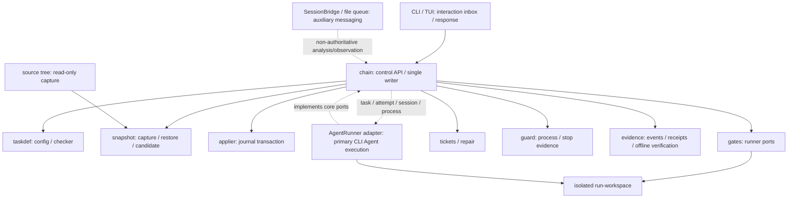

# ProofRail High-Level and Architecture Design

[简体中文](ARCHITECTURE.md)

Date: 2026-09-07; S1 architecture baseline. This document is the normative authority for module boundaries, dependency direction, data flow, and deployment topology. [Project proposal](RFC-proofrail-unattended-ai-engineering-product.md) sections 10-13 and 16 retain design provenance. Inputs: [requirements](PRODUCT_REQUIREMENTS_EN.md) and [business workflows](BUSINESS_WORKFLOWS_EN.md). This document distinguishes implemented modules from target architecture; uncompleted capabilities are not available.

## 1. Current State and Target

T005–T010 currently implement evidence, snapshots, guards, the taskdef change-set checker, applier transactions, the Chain Engine, and a fail-closed gate runner with core tests. Adapters, usable CLI/TUI, and product CI remain incomplete. init/run still print unimplemented messages and their successful exits are not acceptance. Internal modules remain responsibility boundaries and must not be populated with speculative interfaces merely because they appear in the target architecture. AgentRunner prerequisites A0–A7, B1–B4 and C1 are frozen; the T027-B design baseline is settled by P37 / P38.

Use a local single-user, single-writer Go modular monolith. Persist facts as content objects, append-only events and journals. S1 adds no service cluster, database, remote object store or message broker. Prefer Go calls with context.Context internally and versioned protocols across processes.

The CLI Agent is the formal AI execution plane through `AgentRunner`: inside an isolated run-workspace it uses its own agent loop to search, read/write and run allowed tools. ProofRail does not reproduce that loop; it constrains workspace, targets, permissions, network, budgets and processes, captures manifests/diffs, and independently runs gates/review. Agent completion and exit zero are not PASS. `managed-change-set` remains available for deterministic structured edits; only a CLI Agent whose contract and capabilities pass T026 may select isolated-workspace.

AgentRunner selects candidates and execution strategies by normalized `os`, `arch`, and platform-package/build digest; a CLI version never authorizes cross-platform capability reuse. Shared core consumes only platform facts, capability matrices, and fail-closed outcomes and contains no PowerShell, Job Object, POSIX-signal, path-separator, or sandbox-command assumptions. Narrow platform implementations under adapters/guard own environment discovery, process supervision, filesystem behavior, and network enforcement. The current production target is `windows/amd64` only. After the Windows version is complete, `linux/amd64` requires an independent pass on an Ubuntu 24.04 VM or a proven-equivalent environment. macOS, ARM, and other OS/architecture combinations retain extension points but have neither support-matrix entry nor committed schedule; later probes may run in native environments or on GitHub Actions runners. Successful compilation, emulated execution, or a non-equivalent guest on the development host provides feedback only and cannot promote platform capability status.

SessionBridge `silent`, `visible`, and `auto` are not AgentRunner. Silent supports tool-free analysis or change suggestions; visible may bridge supervised black-box candidates; auto is excluded from the formal flow. In black-box mode the operator supervises the external Agent and explicitly returns the isolated workspace; ProofRail reconstructs the candidate from disk and warrants only post-return scans and independent gates/review, not the unobservable process. SessionBridge dialogue, UI delivery and history prove no tool execution, authority, completion or audit fact, and cannot automatically take over writes after AgentRunner failure.

When AI needs operator input, AgentRunner or an auxiliary adapter accepts only structured `operator-action-required` and hands it to chain. Chain persists the request and enters `WAITING_FOR_OPERATOR`; console reads pending work and allowed responses through the control API. Chain validates actor, run/task/attempt, workspace/session, context digest, and authority before persisting a replayable response. Manual writes use the existing handoff lease. Before resuming a CLI Agent, ProofRail revalidates the original session and process state; inability to prove continuity creates a new attempt. SessionBridge `@sbr-review` remains standalone diagnostics/manual testing only.

Test infrastructure: the tests of six core internal packages (adapters/chain/console/gates/guard/tickets) all run under the CI Ubuntu Race leg (`CGO_ENABLED=1 go test -race -count=1`) for race detection; the Windows leg skips the Race step and is unaffected by cgo.

## 2. Ownership and Dependency Contracts

| Module | Owned responsibility/output | Prohibition | First verification |
|---|---|---|---|
| cmd/prfrail | Arguments, composition, exit codes | Domain-state decisions | CLI black-box tests |
| console | Views, command intents, --json, pending-interaction display/response | Direct state/store/receipt writes; treating UI text as authority | Fake control API, narrow terminal, disconnect recovery |
| chain | Transitions, scheduling, effective config, write lock, interaction request/response validation | Concrete adapter imports, free-text PASS/questions | Transition tables, stale/forged responses |
| taskdef | Parsing/schema, references/ownership, sequential checker, doc obligations | Target writes or commands | Valid/invalid goldens |
| snapshot | Capture, materialization, objects, references, GC | Git recovery or unreviewed acceptance | Paths, corruption, quota |
| applier | Full prevalidation, journal, postconditions, group rollback | Validate-while-writing, source writes | Crash at every write boundary |
| gates | Declared hooks and normalized results | Shell string concatenation, task approval | argv, timeouts, artifacts |
| guard | Managed process identity, stop/liveness evidence | PID/lease-expiry-only stop claims | Child processes, PID reuse |
| tickets | Classification, deduplication, lease, attempt/fingerprint budgets | Restarting processes or promotion | Replay, exhaustion |
| repair | Prepare/Inspect/Validate/Promote coordination | Editing formal definitions directly, widening authority | Stale candidates, changed hashes |
| adapters | AgentRunner/auxiliary protocol mapping, platform discovery/strategy selection, capability probes, session/request/process mapping | Cross-platform capability reuse, business-state replacement, authoritative private transcripts, GUI/`@sbr-review` fallback | CLI platform/capability matrix, stop/resume, auxiliary-channel boundary |
| evidence | Encoding/hashes, event chain, receipts, interaction records, offline checks | Execution-plane overwrites, secret storage | Missing/reordered/tampered/replayed data |

Consumers own their ports. AgentPort, GateRunner, ProcessSupervisor, Clock and ObjectStore are responsibility names, not existing exported Go APIs; signatures freeze during the relevant design task. cmd composes implementations; core must not import internal/adapters or console. Avoid an ownerless common package for a few shared fields.

## 3. Data Flow and Transactions

1. Validate TOML/versioned JSON, unknown fields, references, cycles and capabilities. Resolve profile/task/step origins and freeze the run manifest.
2. Capture source read-only, recording excluded .git, run/store, caches and secret paths. Retry/pause if concurrent source changes prevent a coherent capture.
3. Materialize an isolated workspace from the latest accepted parent. managed-change-set uses checker/applier; a capability-verified CLI Agent operates isolated-workspace while ProofRail supervises its process and records manifests/diffs, events/logs, budgets, and stop evidence.
4. Interact only through structured `operator-action-required`: persist the request before entering WAITING_FOR_OPERATOR. Console submits responses through the control API; chain validates attempt/workspace/session binding and authority. Re-probe session/process state before AgentRunner resume. Failure, timeout, disconnect, or persistence failure remains paused. SessionBridge history and Agent transcripts are context, not authoritative state.
5. After blocking gates pass, stop writers, freeze candidate/evidence root and enter REVIEW_PENDING. Independent review binds that candidate; later changes invalidate approval.
6. Publish snapshot/receipt references with a recoverable journal, then persist PASSED facts. Readers consume completed acceptance only. Multiple renames are not a cross-file transaction.
7. On recovery, validate single-writer ownership and the old writer's termination, replay events/journals/pending interactions and rebuild projections. Uncertainty means PAUSED/REPAIR_PENDING, not redispatch of an unknown request.

Reuse RFC section 10.3 states exactly: chain CREATED/BASELINED/RUNNING/PAUSED/COMPLETED/FAILED/CANCELLED; task PENDING/PRECHECK/STEPS_RUNNING/WAITING_FOR_OPERATOR/REVIEW_PENDING/PASSED/FAILED/REPAIR_PENDING/CANCELLED; step PENDING/RUNNING/WAITING_FOR_OPERATOR/PASSED/FAILED/CANCELLED/NOOP_RECORDED. A list of states does not authorize arbitrary transitions.

Preconditions: successful PRECHECK before execution; noop bypasses RUNNING; technical success is not PASSED; FAILED cannot directly become PASSED. cancel/repair/recover/accept require fresh managed-writer stop evidence. Handoff complete revokes the lease, rescans and reruns gates. Events persist before rebuildable projections.

The assembly path the zero-model three-task E2E (P45) pins: the engine materialises workspaces serially in task order, each task takes the `AcceptedParent` of that moment as its parent snapshot, and acceptance advances the parent, so the parent chain is `baselineHash` -> `acceptedOne` -> `acceptedTwo` across T1 / T2 / T3. Failure isolation sits in the task loop: an error from `runTask` marks that task FAILED, fails the chain and stops the remaining tasks, so T3 is neither materialised nor given a task event or a step request; the engine-level tests cross-assert that stop semantics on the workspace call order, the event stream, the projection keys and the step request set, while the console side reproduces the same failure machine through the natural `localRuntime` refusal of a non-noop step. The single-task limit of the console assembly layer was lifted by P50 (see the multi-task serial assembly paragraph below). Concurrent Start exclusion is asserted from outside the package with 8 `Start` calls on one launcher and one runRoot: exactly one winner, every loser hitting only `ErrAgentRunnerLaunchConflict` or `ErrAgentRunnerProcessDuplicate`, the winner `ProcessAlive`, a live winner rejecting a late start, and the slot released after stop so a new start succeeds.

Console multi-task serial assembly (P50): the assembly plan expands a `chain.Definition` into a per-task binding table - `agentRunnerAssemblyPlan` and `supervisedAssemblyPlan` each require exactly one code step per task (isolated-workspace and supervised-black-box respectively) and reject zero tasks with a dedicated message; every `(taskId, stepId, attempt)` binds its own already-persisted `agent-runner-request`, with `agentRunnerAssemblyRecords` enforcing distinct `requestId` values and attempt fixed at 1. The driver loop advances task by task inside the production entry point: wait for that task's dispatch, publish the terminal, load the chain terminal, then route it through submit; any non-completed terminal stops the remaining tasks. The inter-task stop-proof barrier is `proveTaskStopped`, which reuses the three-state `managedProcessesGone` judgement (stopped / still alive / evidence missing) and fails closed on any unmet state, so the next task's R and launch-intent are never published early. CLI wiring is deferred; this slice covers the production assembly layer and the offline harness only.

Console multi-task CLI wiring (P51): `prfrail run` declares `agent-runner-request` records task by task with a repeatable `--request-records <path>`; after decoding, the CLI builds a registry keyed by `agentRunnerRequestRecordKey(taskID, stepID)` and injects it as `AgentRunnerAssemblyOptions.RequestRecords`, while the single-value `--request-record` keeps the single-task compatibility path and the two forms are mutually exclusive. CLI-side fail-closed covers both flags, an empty path, a duplicate key, a key not bound by the chain definition, a definition coverage gap, a record `runId` differing from `--run-id`, and multiple records declared on a noop-only chain; every refusal happens before run-root creation and event-log writes (zero-write). The supervised assembly has no record input, so it is out of that list.

A6 mirror sharing semantics (P50 re-check): the runRoot-level identity mirror and the launch slot are the exclusion point for "**at most one running launch at any instant**", not a once-per-run-lifecycle uniqueness, so serial assembly needs no new lock and produces no concurrent spawn. When tasks switch, the new launch overwrites the mirror atomically via temp file plus rename, consistent with the existing "a mirror naming a dead process is stale and may be replaced" semantics; a losing concurrent Start still must not create log artifacts or overwrite the identity mirror. Instant-level exclusion, mirror rotation and "prove the stop before publishing R" together keep "one mirror per runRoot" valid under shared use.

Scheduling mechanism (P50): the stream key for wire and disk artifacts remains `requestId` (R/C, launch-intent/identity, terminals and evidence directories are all isolated by it), while the assembly layer maps `(runID, taskID, stepID, attempt)` to exactly one request record and the chain layer only knows `runID`; that runRoot's `events/state-events.jsonl` remains the single total-order source. Each task's six frozen facts are attributed by the positional `evidence[2..7]` payload of its own terminal-routing event and must not be reconciled across tasks.

## 4. Storage and Lifecycle

The RFC default snapshot root is out/prfrail/snapshots/. Exact run/state/outbox layouts remain pending contracts, not production paths inferred from this document. Physically separate source, run-workspace, execution outbox and core state/store; reject nested captures and aliased overlap.

Keep baseline, accepted snapshots, final reports and failure evidence by default. Candidate/intermediate TTL follows the profile. GC produces a dry-run list and deletes only unreferenced, expired, unlocked objects. Disk pressure pauses rather than pruning audit evidence. Shared-store GC must coordinate with publication reference updates; a per-run lock alone is insufficient.

### 4.1 Durable Cost Budget (DurableCostLedger)

The budget lives in the run durable ledger; `Reserve` / `Settle` / `RequireOutstandingReservation` always re-read inside the cross-process shared lock before deciding; commits advance in stages, with write, sync, close and replace distinguishable stage by stage, and failures keep three states distinguishable; `unknown` occupancy survives restarts and is neither reused nor re-dispatched.

### 4.2 Concurrency Lock-Order Principles

In-process mutual exclusion precedes the cross-process lock; a lock never spans an external wait; lock waits are cancellable.

- Seal barrier (P43): before a task is accepted the engine writes the candidate closure, the evidence root, both receipts, both decisions and the context digest K into `seals/<runId>/<taskId>.<attempt>.seal.json` (exclusive create + fsync) and only then writes `task-accepted`; `New` and `Recover` re-verify that record for every PASSED task and treat a missing or tampered seal as recovery-uncertain. On re-entry an existing seal with a matching K is reused to rebuild the accepted terminal without calling Reviewer / Publisher again.
- Attempt resolution (P43): `TaskAttemptResolver` is the single source, defaulting to the event projection; workspace materialisation, candidate freeze, review, promotion, postflight fact extraction and the operator / terminal routes all use the same resolved value, and entity keys are recorded per `taskID + attempt`.
- Release order (P48): dropping a file lock and physically removing its path follow one sequence - remove the path, then release the lock, then close the handle - so a scanner never observes an idle lock paired with a path that still exists; when removal fails the lock is released unconditionally, and the residual converges through the same-process ownership gate and the next scan's path re-check rather than being retried inside the release path.

## 5. Trade-Offs

| Decision | Reason | Cost/control |
|---|---|---|
| Single core writer | Explicit ordering/recovery | No S1 parallel task scheduling |
| Local content-addressed files | Standard-library implementation, offline checks | Native Windows/Linux replacement/durability probes |
| TOML entry plus JSON contracts | Human readability, machine strictness | One canonical algorithm; never hash incidental map output |
| External agent ports | No-IDE and multi-model testability | Capability matrix; messaging success is not task success |
| Directory isolation is not a sandbox | Honest S1 guarantees | Reject when requested network/resource/path constraints cannot be enforced |
| Readiness levels and permit linearisation | A lower-level conclusion is never higher-level material | Wrong level fails to compile; a permit quota is spent once |

See [contracts](CONTRACTS_EN.md), [security](SECURITY_EN.md) and [decision register](ADR_REGISTER_EN.md). Do not implement guessed field values before RFC revision.

### 5.1 Acceptance-Chain Security Counterexample Matrix (P52)

Counterexamples bind each gap to tests and land in seven `*_test.go` files: GAP-51 -> T51-1 (break recorded as `t.Skip`); GAP-52 -> T52-1/2; GAP-55 -> T55-1..7; GAP-60 -> T60-1..3; GAP-64 -> T64-1..6; GAP-70 -> T70-1..4.

GAP-77 is a measured break: a Unix intermediate symlink escapes the directory binding and read 23 bytes outside it on Linux go1.22.12; `openat(O_NOFOLLOW)` at `bounddir_unix.go:64` guards only the final component; **fixed in P53** by openat2 single restricted resolution plus fail-closed. GAP-78 (empty ContextKey), GAP-79 (asymmetric normalisation) and GAP-80 (residual isUnderDirectory prefix) remain unbroken candidates.

P53 fix summary: the main path is `openat2(2)` (`RESOLVE_NO_XDEV`, `RESOLVE_NO_MAGICLINKS`, `RESOLVE_NO_SYMLINKS`, `RESOLVE_BENEATH`, linux/amd64 only), and every other platform fails closed (`ENOSYS`, no walk fallback); the related tests are the T51-1 resident regression plus the F1/F2 counterexamples.

Assertion discipline: every counterexample binds a sentinel error through `errors.Is`; a case without a sentinel must anchor its reason in an in-test comment.

## 6. Product Flow Ownership (RFC Section 19)

No new service or generic management module: taskdef builds PC-01 static plans and console displays them, separating execution probes from read-only preview. For PC-02, snapshot/evidence verify accepted references and export; chain records separate delivery events, not console copying the store. PC-03 authorization checks belong to chain dispatch/publication boundaries, in-flight stopping to guard and the approval inbox view to console.

For PC-04, gates/adapters declare capabilities/effects, taskdef checks trusted policy and chain/guard control recovery; evidence produces read-only redacted diagnostics. The AI-secret port and narrow platform backends belong to adapters; console owns only no-echo local input and the `set/status/delete` presentation, while core configuration and evidence retain opaque references only. PC-05 uses tickets for durable budget ledgers, chain for pre-call reservations, adapters for usage and evidence for measurement provenance. Shared cross-run caps need shared coordination, not just per-run locks. PC-06 uses snapshot/evidence for complete reference-closure backups/new-store restore, release tooling for SHA256SUMS, SBOM/license manifests and optional signatures, and chain API for retirement.

New persistent facts are authorization records, preview-plan hashes, export manifests/receipts, cost reservations/settlements and backup/disposition manifests, not new task success states. Source stays read-only; export destinations cannot physically overlap source/run/store. Credentials are excluded from backups. Live backups need a consistency barrier or must wait for stopped writers. Directory separation and declarations do not replace OS enforcement.
